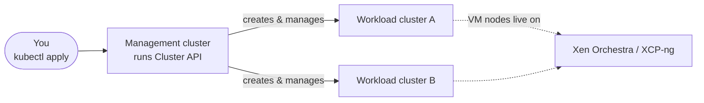

# Cluster API in a nutshell

[Cluster API](https://cluster-api.sigs.k8s.io/) (CAPI) is a Kubernetes
sub-project that applies the Kubernetes way of doing things — declarative
objects, controllers, reconciliation — to *Kubernetes clusters themselves*.

Instead of running a one-off script to stand up a cluster, you describe the
cluster you want as objects, and a set of controllers continuously makes reality
match your description.

## The management cluster

Everything starts with a **management cluster**: an ordinary Kubernetes cluster
whose job is to create and babysit *other* clusters. You install Cluster API and
its providers on it, and from then on you drive everything with `kubectl`.

The clusters the management cluster creates are called **workload clusters**
(sometimes "child" or "tenant" clusters). With vates-capi, the nodes of those
workload clusters are XCP-ng virtual machines.

## Everything is an object

A workload cluster is described by a handful of objects. The two you will see
most often are:

- **`Cluster`** — the logical cluster and its networking details.
- **`Machine`** — one node of that cluster. A control plane node and a worker
  node are both `Machine` objects; what differs is who manages them.

The management cluster stores these objects, and controllers watch them. When a
`Machine` appears, something must actually create a node for it. That "something"
is the interesting part, and it is where providers come in.

## The Machine is abstract on purpose

A `Machine` says *"this cluster needs a node"*. It deliberately says nothing
about **where** the node runs or **how** it is set up. That is split into three
independent responsibilities:

| Responsibility | Question it answers | Who does it |
|---|---|---|
| **Infrastructure** | *Where* does the node live? | an infrastructure provider (vates-capi) |
| **Bootstrap** | *How* does the node join the cluster? | a bootstrap provider (kubeadm, Talos, …) |
| **Control plane** | *Who* runs and scales the control plane? | a control plane provider (kubeadm, Talos, …) |

Each responsibility is implemented by a separate provider. This is the subject
of the [next page](providers.md).

## The contract

For this to work, providers must agree on a shared set of object shapes — a
**contract**. Cluster API defines the contract; each provider implements its own
custom resources following it.

The contract is versioned (the current one is `v1beta2`), and a provider
declares which contract version it implements via `metadata.yaml`, which is what
`clusterctl` checks when you install it.

You rarely need to read the contract in detail to *use* a provider. It matters
most when the parts start talking: a `Machine` doesn't hold a VM, it holds a
*reference* to a custom resource that does. That indirection is the key to the
whole design, and the [next two pages](how-they-link.md) make it concrete.

!!! note "Terminology: "provider" is a role, not a binary"

    The word *provider* is used for two related things: the **company/project**
    shipping a set of controllers (for example, "the Vates provider"), and the
    **type of responsibility** it fills (an *infrastructure* provider). Context
    usually makes it clear, but keep the distinction in mind.
